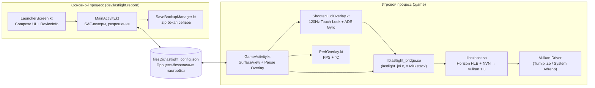

# LastLight Reborn

> **Самостоятельный нативный Android-порт и лаунчер для _Metro: Last Light Redux_ (Nintendo Switch, ARM64 / Vulkan).**

[-3DDC84?style=flat-square&logo=android&logoColor=white)](https://developer.android.com/)
[](https://www.vulkan.org/)
[](https://developer.android.com/jetpack/compose)
[-E5953A?style=flat-square)](#технический-профиль-игры)
[](https://github.com/Meller2/LastLight-reborn/releases/tag/v0.1.0-alpha)

---

## Содержание

1. [О проекте](#о-проекте)
2. [Ключевые возможности](#ключевые-возможности)
3. [Архитектура системы](#архитектура-системы)
4. [Технический профиль игры и исправления движка](#технический-профиль-игры-и-исправления-движка)
   - [Анлок 45 / 60 FPS](#анлок-45--60-fps)
   - [Честное соотношение сторон 20:9 (Ultrawide)](#честное-соотношение-сторон-209-ultrawide)
   - [Исправление графических артефактов (`color_masked`)](#исправление-графических-артефактов-color_masked)
   - [Исправление заиканий звука (`GetAudioOutBufferBufferSize`)](#исправление-заиканий-звука-getaudiooutbufferbuffersize)
   - [Снижение нагрева и write-protection page faults](#снижение-нагрева-и-write-protection-page-faults)
5. [Управление: Touch-Look, гироскоп и геймпады](#управление-touch-look-гироскоп-и-геймпады)
6. [Системные требования](#системные-требования)
7. [Установка и запуск на смартфоне](#установка-и-запуск-на-смартфоне)
8. [Сборка из исходников (Windows / Android NDK)](#сборка-из-исходников-windows--android-ndk)
9. [Структура репозитория](#структура-репозитория)
10. [Переменные окружения хоста (`DM_*`)](#переменные-окружения-хоста-dm_)
11. [Отладка и решение проблем](#отладка-и-решение-проблем)
12. [Дорожная карта](#дорожная-карта)
13. [Правовая информация](#правовая-информация)

---

## О проекте

**LastLight Reborn** (`dev.lastlight.reborn`) — это специализированный нативный порт-лаунчер для запуска **Metro: Last Light Redux** (версия Nintendo Switch 1, `v1.0.0 / v0`, Title ID `0100F0400E850000`, движок **4A Engine**, ARM64, `nnSdk 8.2.0`) напрямую на Android-устройствах без классической JIT-эмуляции CPU.

Исполняемый ARM64-код игры выполняется нативно на процессоре смартфона через тонкий слой Horizon HLE и трансляцию графического API **NVN → Vulkan 1.3** (`peanuts-native` / `libnxhost.so`), обёрнутый в специализированный JNI-мост (`liblastlight_bridge.so`) и собственный интерфейс на **Kotlin + Jetpack Compose**, заточенный под шутер от первого лица.

---

## Ключевые возможности

- **Нативное выполнение ARM64 + Vulkan 1.3** — без JIT-оверхеда CPU, полная предварительная трансляция всех 854 шейдеров (`romfs/shaders.nx` → `dmsh_vk.lib`) с нулём ошибок `spirv-val`.
- **Анлок 30 / 45 / 60 FPS** — чистая разблокировка зашитого лимита `30 FPS` с сохранением корректной дельта-физики и таймингов 4A Engine.
- **Честный полноэкранный режим 20:9 / 21:9** — без растягивания картинки и искажения пропорций (5-точечный патч `display_device` + динамического разрешения).
- **Современный лаунчер в стилистике Metro** — боковая навигация, карточка реального железа устройства (`SoC`, `GPU`, `RAM`, `Android`), живая температура батареи, быстрые профили (`Холодный 30` / `Баланс 45` / `Максимум 60`), апскейлеры `SGSR1` / `FSR1`, поддержка кастомных драйверов **Turnip** (`.zip` через AdrenoTools) и бэкап/восстановление сохранений в `.zip`.
- **Шутерный сенсорный HUD** — плавающий левый стик с авто-спринтом (`L3`), правая половина экрана для свободного Touch-Look с 120 Гц аккумулятором углового импульса (быстрые флики больше не «съедаются» клиппингом стика), аппаратный гироскоп (`Выкл / В прицеле ZL / Всегда`) и подлинные подписи кнопок Nintendo Switch (`A`, `B`, `X`, `Y`, `ZL`, `ZR`, `L`, `R`, `R3`, `−`, `+`, крестовина).
- **Полная поддержка физических геймпадов** — автоматическое скрытие сенсорного HUD при нажатии на геймпад и возврат при касании экрана.
- **Изолированный игровой процесс (`:game`)** — чистый жизненный цикл, процесс-безопасный JSON-конфиг (`lastlight_config.json`) с живой подстройкой чувствительности и гироскопа прямо в паузе, корректный выход в лаунчер без утечек состояния.
- **Двуязычный интерфейс** — полная локализация на русском (`RU`) и английском (`EN`).

---

## Архитектура системы



### Ключевые архитектурные правила
1. **Выделенный процесс `:game`:** `nxhost_main` в `libnxhost.so` нельзя инициализировать повторно внутри одного процесса. `GameActivity` всегда работает в `android:process=":game"`, а при закрытии (`onDestroy` / кнопка выхода) вызывает `NativeBridge.terminateProcess()` (`_exit(0)`).
2. **Без `SharedPreferences`:** для мгновенной синхронизации настроек между `MainActivity` и `:game` (включая живую подстройку в меню паузы) используется атомарная запись в `filesDir/lastlight_config.json` (`AppPrefs.kt`).
3. **Отключение Pointer Tagging:** в `AndroidManifest.xml` обязательно установлен `android:allowNativeHeapPointerTagging="false"` — тегирование указателей Scudo на Android 11+ ломает гостевые адреса ARM64.
4. **Стек 8 MiB:** поток `nxhost_main` запускается с увеличенным стеком `8 MiB` (`HOST_STACK`), а `stdout`/`stderr` перенаправляются через `pipe2` одновременно в logcat (`LastLight`) и в файл сессии `/sdcard/Android/data/dev.lastlight.reborn/files/logs/`.

---

## Технический профиль игры и исправления движка

| Параметр | Значение |
|---|---|
| **Игра** | Metro: Last Light Redux (Nintendo Switch 1) |
| **Title ID / Build** | `0100F0400E850000` / `v0` (`1.0.0`) |
| **Build ID `main`** | `85c362cc9790f0edf23749b041953c51` (13.3 MB `.text`) |
| **Build ID `sdk`** | `3ae34e689d7a35f13cbf42bfd672af8b` (`nnSdk 8.2.0`) |
| **Модули** | `main`, `rtld`, `sdk` (без `subsdk`, без runtime GLSLC) |
| **Шейдеры** | `romfs/shaders.nx` (16.4 MB) → **854** уникальных (463 PS, 391 VS, 913 пар) → 880 SPIR-V модулей в `dmsh_vk.lib` (2.4 MB) |
| **Аудио** | `nn::audio::AudioOut` (стерео 48 кГц) + программный ресемплер SDK (без `AudioRenderer`) |
| **Видеоролики** | `.ogv`, программное декодирование средствами 4A Engine (без `nn::movie`) |
| **Depth mode** | `zero` (`nvnDeviceSetDepthMode(near = 0)`) |

### Анлок 45 / 60 FPS
На Switch игра жёстко залочена на 30 FPS вызовом `nvnWindowSetPresentInterval(win, 2)` (`main+0xa83f00`, `mov w1, #2`). Поскольку 4A Engine полностью работает от `delta-time`, разблокировка выполняется без модификации геймплейной логики:
- `fps_limit_present 1`, `fps_limit_max 60` в профиле игры;
- при выборе `45` или `60 FPS` передаются `DM_PRESENT_INTERVAL=display`, `DM_PRESENT_HZ=<45|60>` и `DM_FPS_TARGET=<45|60>`.

### Честное соотношение сторон 20:9 (Ultrawide)
Реверс-инжиниринг `main` показал, что 4A Engine хранит соотношение экрана, рендера и пиксельный аспект в полях объекта `display_device`:
- `[device + 0xb8]` (`[x19 + 0x28]`) — screen aspect (`16/9`);
- `[device + 0xbc]` (`[x19 + 0x2c]`) — render aspect (`16/9`);
- `[device + 0xc0]` (`[x19 + 0x30]`) — pixel aspect (`cur_w / (aspect * cur_h)`).

Патчить только константу `0x12fc198` недостаточно — при инициализации (`0x5a550`) соотношение собирается inline через `MOVZ`/`MOVK`, а при каждом тике динамического разрешения (`0x5a450` и `0x5a610`) пересчитывается через `fdiv s1, s0, s1` (`1280 / 720`) и затирает поля обратно в `16:9`.

Поэтому в `DM_ASPECT_PLAN` и `game.tsv` применяется **5-точечный патч** до опечатывания `.text`:

| Смещение в `main` | Инструкция | Тип патча `aspect_plan` | Назначение |
|---|---|---|---|
| `m0x5a504` | `fdiv s1, s0, s1` (`0118211e`) | `ratio_fmov` | Пересчёт аспекта в методе динамического разрешения №1 |
| `m0x5a5c8` | `movz w9, #0x8e39` (`29c79152`) | `ratio_movz` | Младшие 16 бит `float(16/9)` при инициализации |
| `m0x5a5cc` | `movk w9, #0x3fe3, lsl #16` (`69fca772`) | `ratio_movk` | Старшие 16 бит `float(16/9)` при инициализации |
| `m0x5a5f0` | `ldr s0, [x8, #0x198]` (`009941bd`) | `ratio_fmov` | Загрузка `16/9` для расчёта `pixel_aspect` при старте |
| `m0x5a6c4` | `fdiv s1, s0, s1` (`0118211e`) | `ratio_fmov` | Пересчёт аспекта в методе динамического разрешения №2 |

Физическое разрешение берётся из `WindowManager.maximumWindowMetrics.bounds` и передаётся в `DM_VK_PICTURE_ASPECT=<w>:<h>`. В результате 3D-камера честно расширяет горизонтальный FOV, а прицелы и элементы HUD не растягиваются.

### Исправление графических артефактов (`color_masked`)
Metro очищает пост-процесс / refraction-буфер через `nvnCommandBufferClearColor` с компонентной маской `0x3` (`R+G` без `B+A`). Пропуск такого clear вызывал размазанные «капли» в центре экрана. В `peanuts-native/dm/gfx/vk_android/vka_exec.c` реализован `color_masked(...)` — полноэкранный треугольник с push-constant SPIR-V фрагментными шейдерами (`vka_cmc_frag_f` / `vka_cmc_frag_u`) и выставленным `colorWriteMask`.

### Исправление заиканий звука (`GetAudioOutBufferBufferSize`)
В `peanuts-native/dm/host/hle_audio.c` добавлен `HLE_FORCE`-хук `h_au_BufCap` для `_ZN2nn5audio27GetAudioOutBufferBufferSizeEPKNS0_14AudioOutBufferE`, возвращающий `b->cap`. Без него вызов проваливался в гостевой `sdk` и читал неверное смещение структуры, вызывая сильное заикание звука.

### Снижение нагрева и write-protection page faults
На стандартном постраничном трекинге грязной памяти Metro генерирует ~2.3M write-protection faults при 0 реальных перезагрузок. Включение `DM_DIRTY_BLOCK_AT=0` + `DM_DIRTY_BLOCK_KB=64` радикально снижает частоту фолтов и нагрев CPU. Также используется `DM_VK_PSO_ASYNC=0` (кэш пайплайнов сохраняется в `temp/0100F0400E850000/vk_pipelines-*.bin`), что исключает пропуски отрисовки и мерцание на новых сценах.

---

## Управление: Touch-Look, гироскоп и геймпады

### Touch-Look с аккумулятором углового импульса (`LookAccumulator`)
Обычная конвертация `dx -> clamp(stick, -1, 1)` страдает от фундаментальной проблемы аналогового стика: при быстром свайпе (30–50 мс) значение упирается в `1.0`, до 75% движения отбрасывается, и камера едва поворачивается, тогда как медленное движение на ту же дистанцию разворачивает её в разы сильнее.

В [ShooterHudOverlay.kt](app/src/main/java/dev/lastlight/reborn/ui/hud/ShooterHudOverlay.kt) реализована схема с очередью углового смещения:
1. Дельта пальца переводится в плотностно-независимые `dp` (`dx / density`, `dy / density`) и суммируется в буфер `(pendingX, pendingY)` в единицах *stick-seconds* (кап `0.24 с`).
2. Отдельный 120 Гц цикл (`delay(8)`, реальный `dt` по `System.nanoTime()`) выдаёт скорость стика `pending / tau` (`tau = 22 мс`), клиппирует её **радиально** (сохраняя точный угол диагональных фликов) и вычитает из буфера только фактически отданный за тик импульс `eff * dt`.
3. При смене направления (`dx * pendingX < 0`) остаток по этой оси **мгновенно обнуляется**; при остановке пальца на экране (>45 мс) остаток быстро затухает — никакой «вязкости» при точной доводке.
4. Применяется 2D-радиальная компенсация мёртвой зоны и инверсия прогрессивной кривой стика 4A Engine (`mag^0.76`), при этом хостовый `inputDeadzone` выставляется в `0.0f` (чтобы не было двойной мёртвой зоны).

### Аппаратный гироскоп
- Хостовый SixAxis отключён (`DM_MOTION=0`, `DM_PHONE_MOTION=0`) — сенсором полностью управляет `ShooterHudOverlay`.
- Режимы: **Выкл**, **В прицеле (ZL)**, **Всегда** (переключаются в лаунчере и прямо в паузе).
- Применены EMA-сглаживание (`alpha = 0.42`) и 2D-радиальный порог от микротремора рук.
- В режиме **Toggle ADS** прицел (и гироскоп в режиме `ZL`) автоматически сбрасывается при срабатывании авто-спринта (`L3`), перезарядки (`X`), нажатия `+` / `−` или открытия паузы.

### Раскладка кнопок Nintendo Switch
- **Левая половина экрана:** плавающий стик движения (упор вверх → авто-спринт `L3`), дополнительная кнопка `ZR` сверху слева для игры в 3 пальца (claw).
- **Верхняя панель:** `L`, `◀`, `▲`, `▼`, `▶`, `R`, `−`, `+`, `≡` (пауза).
- **Правый блок:** `ZR` (огонь), `ZL` (прицел с зелёным индикатором фиксации), `X`, `Y`, `A`, `B`, `R3`.
- Виртуальный геймпад регистрируется с `labelled = 1`, поэтому `KEYCODE_BUTTON_A/B/X/Y` соответствуют 1:1 маркировке Nintendo Switch.

---

## Системные требования

| Компонент | Минимум | Рекомендуется (проверено) |
|---|---|---|
| **ОС** | Android 13 (API 33) | Android 14–16 (API 34–36) |
| **Архитектура** | `arm64-v8a` | `arm64-v8a` |
| **Процессор / GPU** | Snapdragon 8 Gen 2 / Adreno 740 (Vulkan 1.3) | Snapdragon 8 Gen 3 (`SM8650`, Adreno 750) |
| **Драйвер GPU** | Системный Vulkan 1.3 | Mesa Turnip (`v26.0.0_R8` AdrenoTools `.zip`) |
| **ОЗУ** | 8 ГБ | 12–16 ГБ |
| **Хранилище** | ~9 ГБ свободного места | UFS 3.1 / 4.0 (~9 ГБ под `.nup` + `android-pack` + кэш PSO) |
| **Права** | Доступ ко всем файлам (`MANAGE_EXTERNAL_STORAGE`) | Обязательно для чтения `.nup` и `android-pack` |

---

## Установка и запуск на смартфоне

1. Скачайте и установите последний APK из [GitHub Releases](https://github.com/Meller2/LastLight-reborn/releases) (`LastLightReborn-v0.1.0-alpha-arm64.apk`).
2. Подготовьте легально полученную копию **Metro: Last Light Redux** (Switch `v0`, `0100F0400E850000`) в формате `.nup` + `android-pack` (`main.patched.bin`, `sdk.patched.bin`, `pack.tsv`, `shaders/.../dmsh_vk.lib`) и поместите в папку на устройстве, например:
   ```text
   /sdcard/Download/content/Games/Nintendo/Games/Metro Last Light Redux/
   ├── Metro Last Light Redux [0100F0400E850000][v0].nup
   ├── Metro Last Light Redux [0100F0400E850000][v0].png        # опционально (обложка)
   └── 0100F0400E850000-work/
       └── android-pack/
           ├── main.patched.bin
           ├── sdk.patched.bin
           ├── pack.tsv
           └── shaders/.../dmsh_vk.lib
   ```
3. Откройте **LastLight Reborn**, выдайте разрешение на доступ к хранилищу (`Разрешить доступ`).
4. Нажмите кнопку папки рядом с `Запуск` (или откройте вкладку **Файлы → Выбрать папку / Автопоиск**) и укажите папку с игрой. Все 3 индикатора (`NUP`, `Pack`, `Shaders`) должны загореться зелёным.
5. *(Рекомендуется для Adreno)* Во вкладке **Файлы → Драйвер Turnip (.zip)** выберите архив AdrenoTools Turnip (например, `Turnip_v26.0.0_R8.zip`). Лаунчер сам распакует `.so` и прочитает `meta.json`.
6. Выберите профиль (`Холодный 30` / `Баланс 45` / `Максимум 60`) и нажмите **`▶ Запуск`**.

---

## Сборка из исходников (Windows / Android NDK)

### 1. Клонирование и применение локальных патчей `peanuts-native`
```powershell
git clone --recursive https://github.com/Meller2/LastLight-reborn.git
cd LastLight-reborn

# Применить фиксы (masked clear, AudioOut HLE, NDK param) и профиль Metro
git -C peanuts-native apply ..\patches\peanuts-native.patch
New-Item -ItemType Directory -Force -Path "peanuts-native\dm\games\0100F0400E850000" | Out-Null
Copy-Item -Path "patches\0100F0400E850000\*" -Destination "peanuts-native\dm\games\0100F0400E850000\" -Force
```

### 2. Требования к окружению сборки
- **JDK 21** (например, Microsoft OpenJDK 21)
- **Android SDK:** `platforms;android-36`, `build-tools;36.0.0`, `cmake;3.22.1`, **`ndk;29.0.14206865`**
- **Python 3** (в `PATH` должен быть доступен исполняемый файл `python3` — его вызывает CMake при сборке `libnxhost.so`)
- `local.properties` с путём `sdk.dir=...`

### 3. Сборка Release APK и установка по ADB (PowerShell)
```powershell
$envDir = "D:\GameDev\Ports\LastLight-reborn\work\bananative\env"
$env:JAVA_HOME = "C:\Program Files\Microsoft\jdk-21.0.11.10-hotspot"
$env:ANDROID_HOME = "$env:LOCALAPPDATA\Android\Sdk"
$cmakeBin = "$env:ANDROID_HOME\cmake\3.22.1\bin"
$env:PATH = "$envDir;$envDir\Library\bin;$envDir\Scripts;$env:JAVA_HOME\bin;$cmakeBin;$env:PATH"

.\gradlew.bat :app:assembleRelease
adb install -r "app\build\outputs\apk\release\app-release.apk"
```

---

## Структура репозитория

```text
LastLight-reborn/
├── app/
│   ├── build.gradle.kts                     # Android/Compose/CMake конфигурация (c++_static, arm64-v8a)
│   └── src/main/
│       ├── AndroidManifest.xml              # sensorLandscape, :game process, pointerTagging=false
│       ├── cpp/
│       │   ├── CMakeLists.txt               # Сборка libnxhost.so (GAME=0100F0400E850000) + liblastlight_bridge.so
│       │   └── lastlight_jni.c              # JNI-мост, лог-пайп, 8 MiB поток nxhost_main, _exit(0)
│       └── java/dev/lastlight/reborn/
│           ├── MainActivity.kt              # Точка входа лаунчера и системные SAF-пикеры
│           ├── GameActivity.kt              # :game процесс, SurfaceView, геймпады, меню паузы
│           ├── nativecore/NativeBridge.kt   # JNI-обвязка liblastlight_bridge.so
│           ├── data/
│           │   ├── AppPrefs.kt              # Процесс-безопасный JSON-конфиг (PerfPreset, GyroMode)
│           │   ├── DeviceInfo.kt            # Реальные SoC, GPU, RAM, Android и температура батареи
│           │   ├── GamePaths.kt             # Поиск .nup/pack/shaders, распаковка Turnip, сборка DM_* env
│           │   └── SaveBackupManager.kt     # Экспорт / импорт сохранений в .zip
│           └── ui/
│               ├── LauncherScreen.kt        # Главный интерфейс лаунчера (боковая панель + бенто-дашборд)
│               ├── Strings.kt               # Локализация RU / EN
│               ├── theme/MetroTheme.kt      # Цветовая палитра и типографика Metro
│               └── hud/
│                   ├── ShooterHudOverlay.kt # Сенсорный шутер-HUD, 120Hz Touch-Look, ADS-гироскоп
│                   └── PerfOverlay.kt       # Живой оверлей FPS и температуры батареи
├── patches/
│   ├── peanuts-native.patch                 # Дифф локальных правок поверх upstream peanuts-native
│   └── 0100F0400E850000/                    # Полный профиль Metro: Last Light Redux (game.tsv, shaders)
├── peanuts-native/                          # Git submodule (Horizon HLE + NVN → Vulkan 1.3 ядро)
├── AGENTS.md                                # Техническая памятка проекта
├── PLAN.md                                  # Дорожная карта по этапам
└── README.md                                # Документация проекта
```

---

## Переменные окружения хоста (`DM_*`)

Основные переменные, которые `GamePaths.buildHostEnv(...)` передаёт в `libnxhost.so`:

| Переменная | Значение / диапазон | Назначение |
|---|---|---|
| `DM_ROMFS` | `<path.nup>:base/romfs` | Подключение RomFS напрямую из `.nup` |
| `DM_SAVE` / `DM_TEMP` | `.../files/saves/...`, `.../temp/...` | Каталоги сохранений и кэша Vulkan PSO |
| `DM_VK_SHLIB` | `<path>/dmsh_vk.lib` | Предтранслированная библиотека SPIR-V шейдеров |
| `DM_RES_SCALE` | `0.50` .. `1.00` | Масштаб внутреннего рендера |
| `DM_VK_NDSR` / `DM_VK_FSR` | `4/0` (SGSR1), `2/1` (FSR1), `1/0` (Off) | Выбор апскейлера |
| `DM_PRESENT_INTERVAL` | `display` (>30 FPS) / `game` (30 FPS) | Переопределение `nvnWindowSetPresentInterval` |
| `DM_PRESENT_HZ` / `DM_FPS_TARGET` | `30`, `45`, `60` | Целевая частота кадров |
| `DM_VK_PICTURE_ASPECT` | `<sw>:<sh>` (при включённом 20:9) | Физическое соотношение сторон экрана |
| `DM_ASPECT_PLAN` | 5 строк (`ratio_fmov/movz/movk`) | Патч проекции и динамического разрешения 4A Engine |
| `DM_DIRTY_BLOCK_AT` / `DM_DIRTY_BLOCK_KB` | `0` / `64` | Крупноблочный трекинг памяти для снижения page faults |
| `DM_VK_DRIVER` | `filesDir/gpu_driver/<turnip>.so` | Подгрузка кастомного драйвера AdrenoTools Turnip |
| `DM_VK_PSO_ASYNC` | `0` | Синхронная компиляция PSO (без миганий и пропусков) |
| `DM_MOTION` / `DM_PHONE_MOTION` | `0` / `0` | Отключение хостового SixAxis в пользу ADS-гироскопа HUD |
| `DM_LANG` | `ru` / `en-US` | Язык локали для игры |

---

## Отладка и решение проблем

### Где искать логи
Каждый запуск `:game` пишет полный лог на устройство:
```text
/sdcard/Android/data/dev.lastlight.reborn/files/logs/lastlight-YYYYMMDD-HHMMSS.log
```
Стянуть последний лог и отфильтровать ошибки `[RED]`:
```powershell
adb shell "ls -t /sdcard/Android/data/dev.lastlight.reborn/files/logs/ | head -n 1"
adb pull /sdcard/Android/data/dev.lastlight.reborn/files/logs/ .\work\logs\
adb logcat -s LastLight:V
```

### Частые проблемы
- **Кнопка «Запуск» неактивна (`Нет файлов`):** проверьте, что выдано разрешение «Доступ ко всем файлам» (`MANAGE_EXTERNAL_STORAGE`), а выбранная папка содержит `.nup` и `android-pack` (`main.patched.bin` / `pack.tsv`).
- **Артефакты или вылет на стоковом драйвере Adreno:** установите свежий драйвер **Turnip** `.zip` (проверено на `Turnip v26.0.0_R8`) во вкладке **Файлы** и включите **Turnip** во вкладке **Графика**.
- **Прицел (ZL) остаётся активным после нажатия:** по умолчанию включён режим `Прицел по нажатию (Toggle)` — его можно переключить на удержание прямо в меню паузы (`≡`) или во вкладке **Управление**.
- **Сильный нагрев в 60 FPS:** переключитесь на профиль **Баланс (45 FPS • 0.85x • SGSR1)** или **Холодный (30 FPS • 0.75x)** прямо с главного экрана в карточке **Профили**.

---

## Дорожная карта

Подробный трекер ведётся в [PLAN.md](PLAN.md):

- [x] **Базовый bring-up:** импорт `v0`, 854/854 валидных SPIR-V шейдеров, фиксы `color_masked` и `GetAudioOutBufferBufferSize`, 25+ мин стабильного геймплея.
- [x] **Этап 1 — Лаунчер и управление:** выделенный `:game` процесс, SAF-пикеры, бэкап сейвов, шутер-HUD, оверлей FPS/°C.
- [x] **Этап 2 — 60 FPS, 20:9, гироскоп, Touch-Look и редизайн UI:**
  - [x] Анлок 45 / 60 FPS (`DM_PRESENT_INTERVAL=display`)
  - [x] Честное соотношение сторон 20:9 (5-точечный `DM_ASPECT_PLAN`)
  - [x] ADS-гироскоп и 120 Гц аккумулятор фликов Touch-Look
  - [x] Стеклянный дизайн лаунчера с карточкой устройства и бенто-дашбордом
  - [ ] Вшитый `vk_prewarm.bin` для мгновенного старта без компиляции PSO
  - [ ] Редактор расположения и размеров кнопок HUD
- [ ] **Этап 3 — Полная автономность на смартфоне:** интеграция `libnximport.so` + on-device пайплайн сборки из `.nsp` + `prod.keys` + `firmware.zip` прямо на телефоне без ПК.

---

## Правовая информация

- Репозиторий **не содержит** никаких игровых ресурсов, ROM/образов (`.nsp`, `.xci`, `.nup`), криптографических ключей (`prod.keys`), дампов прошивки или скомпилированных шейдеров игры.
- Для работы приложения пользователь обязан использовать **собственную легально приобретённую копию** _Metro: Last Light Redux_ для Nintendo Switch.
- _Metro: Last Light Redux_ и 4A Engine являются товарными знаками 4A Games / Deep Silver. Nintendo Switch — товарный знак Nintendo Co., Ltd. Проект создан в исследовательских и образовательных целях и не аффилирован с правообладателями.
